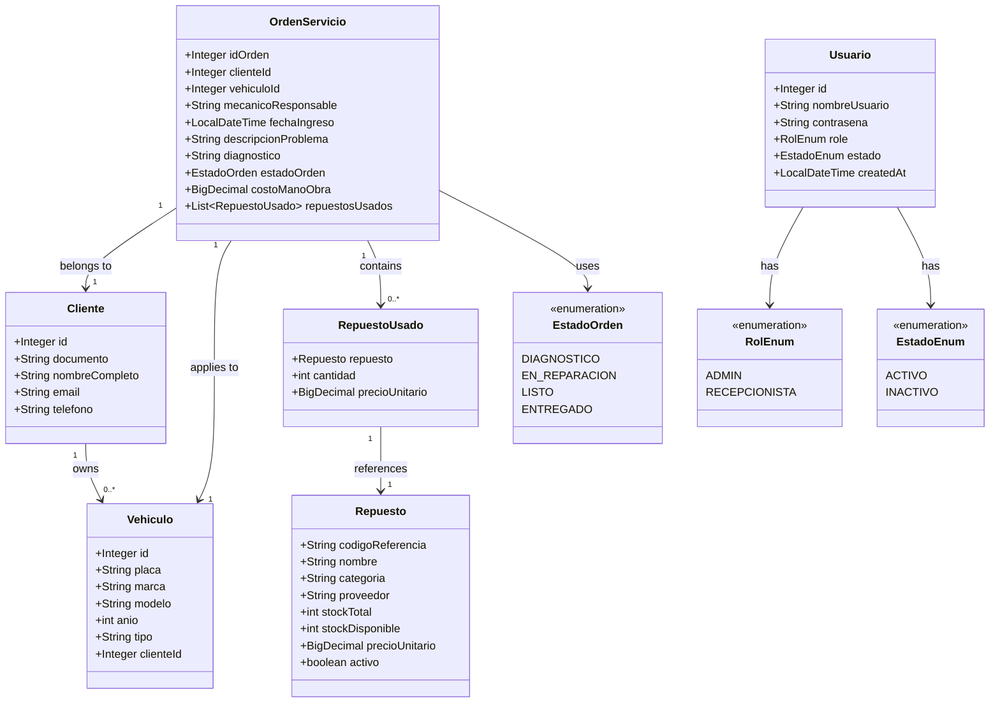
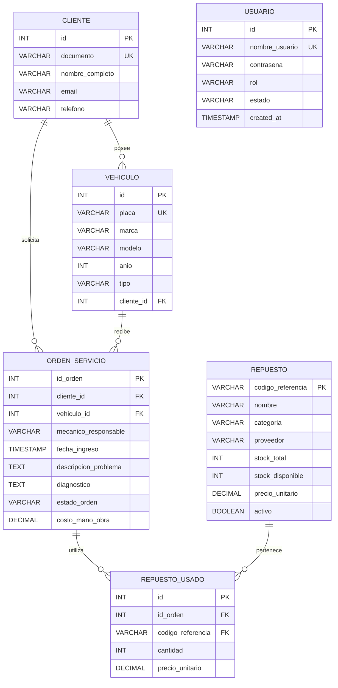
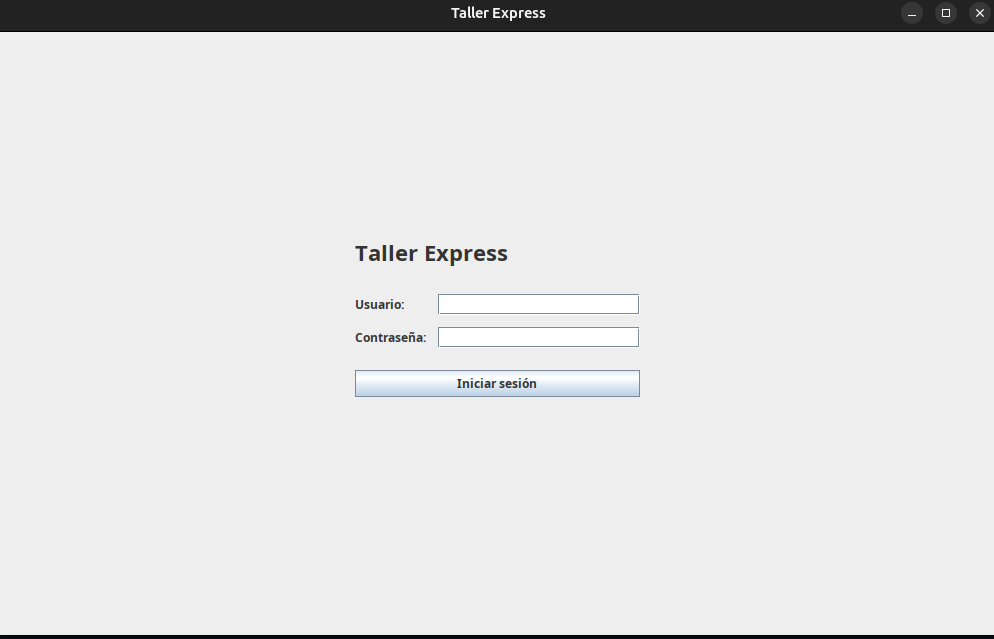
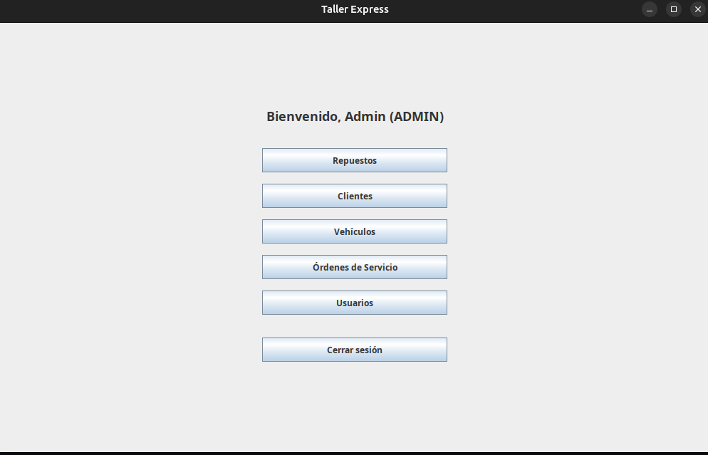
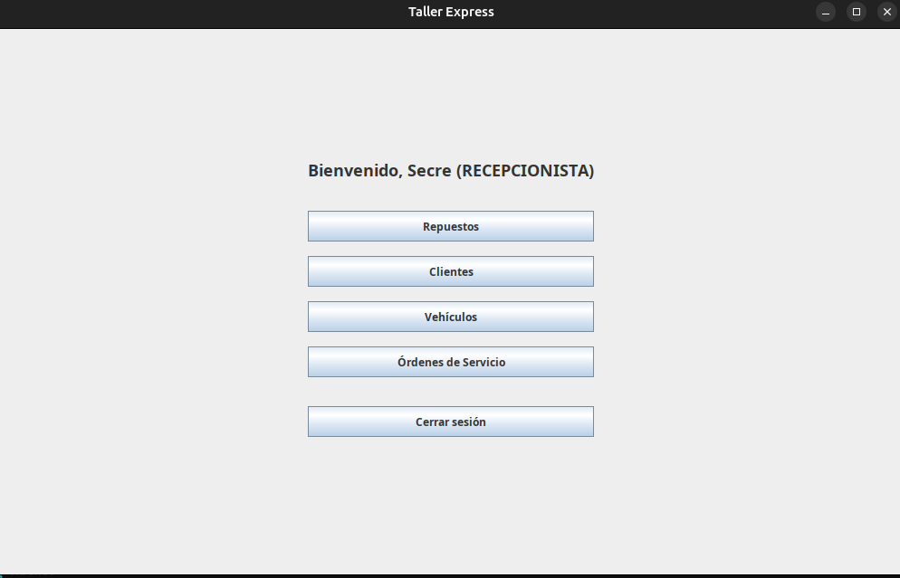
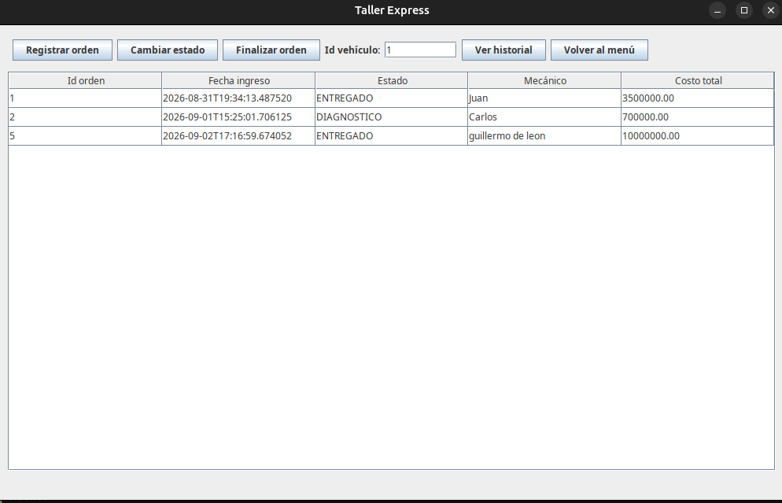
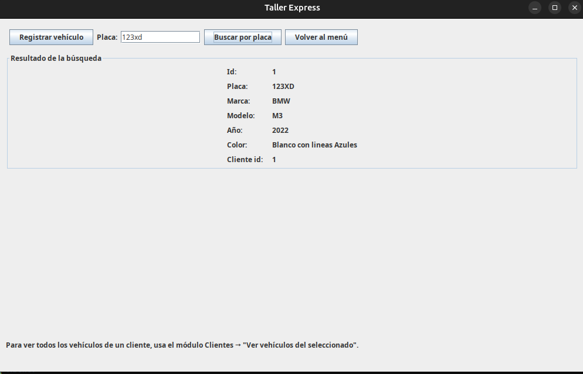

# TallerExpress – Spare Parts & Service Order Management

Desktop application developed in **Java 17+** for managing an automotive workshop, using **JFrame** as the graphical interface, **JDBC** for persistence, and **PostgreSQL** as the database engine.

The project follows a layered architecture based on **Model, Repository, Service, Controller, and View**, with business validations, custom exceptions, authentication, role-based access, inventory management, and service-order management.

---

## 📋 Description

**TallerExpress** centralizes the main operations of an automotive workshop.

The system allows users to manage:

* Customers.
* Vehicles associated with customers.
* Spare parts and inventory.
* Service orders.
* Users and roles.
* Service-order status.
* Spare parts used in service orders.
* Vehicle service history.

The application uses a relational PostgreSQL database and communicates with it through **JDBC**, keeping the persistence logic separated from the business logic.

---

## ✨ Main Features

### 👥 Customer Management

* Register customers.
* Search customers.
* Update customer information.
* Delete customers.
* List registered customers.
* Validate duplicate customer information.

### 🚗 Vehicle Management

* Register vehicles.
* Associate vehicles with customers.
* Search vehicles.
* Update vehicle information.
* Delete vehicles.
* List vehicles.
* Validate duplicate license plates.

### 🔧 Spare Parts Management

* Register spare parts.
* Search spare parts by reference code.
* Update spare parts.
* Change spare-part active/inactive status.
* Filter spare parts by category.
* Filter spare parts by supplier.
* Control total and available stock.
* Validate insufficient stock.

### 🧾 Service Orders

* Register service orders.
* Associate an order with a customer and vehicle.
* Register the responsible mechanic.
* Record the problem description.
* Register a diagnosis.
* Add spare parts to an order.
* Calculate service-order costs.
* Change the order status.
* Finalize service orders.
* Consult the service history of a vehicle.

### 🔐 Authentication & Users

* User login.
* Credential validation.
* Disabled-user validation.
* User registration.
* Role-based authorization.
* User listing.
* User deletion.
* Different permissions for `ADMIN` and `RECEPCIONISTA`.

---

## 🛠️ Technologies

| Technology               | Purpose                               |
| ------------------------ | ------------------------------------- |
| Java 17+                 | Main programming language             |
| Java Swing / JFrame      | Graphical user interface              |
| JDBC                     | Database connectivity and persistence |
| PostgreSQL 16            | Relational database                   |
| Docker / Docker Compose  | PostgreSQL environment                |
| Maven                    | Dependency and project management     |
| Git / GitHub             | Version control                       |

---

## 📁 Package Structure

```text
src/main/java/com/prueba_desenpeno_java/

├── config/
│   └── ConexionBD.java
│
├── exception/
│   ├── ClienteNotFoundException.java
│   ├── DuplicateRepuestoException.java
│   ├── DuplicateVehiclePlacaException.java
│   ├── InsufficientStockException.java
│   ├── InvalidCredentialsException.java
│   ├── InvalidOrderStateException.java
│   ├── OrderNotFoundException.java
│   ├── PersistenceException.java
│   ├── RepuestoNotFoundException.java
│   ├── UnauthorizedRoleException.java
│   ├── UserDisabledException.java
│   └── VehiculoNotFoundException.java
│
├── model/
│   ├── Cliente.java
│   ├── EstadoEnum.java
│   ├── EstadoOrden.java
│   ├── OrdenServicio.java
│   ├── Repuesto.java
│   ├── RepuestoUsado.java
│   ├── RolEnum.java
│   ├── Usuario.java
│   └── Vehiculo.java
│
├── repository/
│   ├── ClienteRepository.java
│   ├── CrudRepository.java
│   ├── OrdenServicioRepository.java
│   ├── RepuestoRepository.java
│   ├── UsuarioRepository.java
│   ├── VehiculoRepository.java
│   │
│   └── impl/
│       ├── ClienteRepositoryImpl.java
│       ├── OrdenServicioRepositoryImpl.java
│       ├── RepuestoRepositoryImpl.java
│       ├── UsuarioRepositoryImpl.java
│       └── VehiculoRepositoryImpl.java
│
├── service/
│   ├── ClienteService.java
│   ├── OrdenServicioService.java
│   ├── RepuestoService.java
│   ├── UsuarioService.java
│   ├── VehiculoService.java
│   │
│   └── impl/
│       ├── ClienteServiceImpl.java
│       ├── OrdenServicioServiceImpl.java
│       ├── RepuestoServiceImpl.java
│       ├── UsuarioServiceDefaultsDecorator.java
│       ├── UsuarioServiceImpl.java
│       └── VehiculoServiceImpl.java
│
├── controller/
│   ├── ClienteController.java
│   ├── OrdenServicioController.java
│   ├── RepuestoController.java
│   ├── UsuarioController.java
│   └── VehiculoController.java
│
├── view
│   ├── forms
│   │   ├── CambiarEstadoOrdenFrame.java
│   │   ├── ClienteFormFrame.java
│   │   ├── FinalizarOrdenFrame.java
│   │   ├── HistorialVehiculosFrame.java
│   │   ├── OrdenServicioFormFrame.java
│   │   ├── RepuestoFormFrame.java
│   │   ├── UsuarioFormFrame.java
│   │   └── VehiculoFormFrame.java
│   ├── MainFrame.java
│   ├── MenuPrincipal.java
│   ├── panels
│   │   ├── ClientePanel.java
│   │   ├── LoginPanel.java
│   │   ├── MenuPanel.java
│   │   ├── OrdenServicioPanel.java
│   │   ├── Refrescable.java
│   │   ├── RepuestoPanel.java
│   │   ├── UsuarioPanel.java
│   │   └── VehiculoPanel.java
│   └── util
│       ├── Mensajes.java
│       └── TableUtil.java
│
└── Prueba_desenpeno_java.java
```

---

## 📊 Class Diagram



---

## 📊 Relational Model


---

## 🗄️ Database

The project uses **PostgreSQL 16** running inside Docker.

The provided `docker-compose.yml` configures the database as follows:

```yaml
services:
  postgres-db:
    image: postgres:16
    container_name: tallerexpress_postgres
    restart: unless-stopped
    environment:
      POSTGRES_USER: postgres
      POSTGRES_PASSWORD: postgres_123
      POSTGRES_DB: taller_express
    ports:
      - "5434:5432"
    volumes:
      - postgres_data:/var/lib/postgresql/data
      - ./db-init:/docker-entrypoint-initdb.d

volumes:
  postgres_data:
```

### Database Configuration

| Parameter | Value            |
| --------- | ---------------- |
| Host      | `localhost`      |
| Port      | `5434`           |
| Database  | `taller_express` |
| User      | `postgres`       |
| Password  | `postgres_123`   |

> The PostgreSQL container exposes its internal port `5432` through port `5434` on the host machine.

---

## 🐳 Running PostgreSQL with Docker Compose

From the project root:

```bash
docker compose up -d
```

To stop the database:

```bash
docker compose down
```

To completely remove the database volume and recreate the database:

```bash
docker compose down -v
docker compose up -d
```

> Using `down -v` removes the PostgreSQL volume and therefore deletes the persisted database data.

---

## 🚀 Setup and Execution

### 1. Clone the repository

```bash
git clone <repository-url>
cd prueba_desenpeno_java
```

### 2. Start PostgreSQL

Make sure Docker is running and execute:

```bash
docker compose up -d
```

### 3. Build the project

Using Maven:

```bash
mvn clean package
```

### 4. Run the application

Run the main class:

```text
com.prueba_desenpeno_java.Prueba_desenpeno_java
```

The application will open the login interface using `JFrame`.

---

## 🔑 Available Users

The following users are already registered in the database and can be used to access the application:

| Username    | Password       | Role            | Status   |
| ----------- | -------------- | --------------- | -------- |
| `admin`     | `123`     | `ADMIN`         | `ACTIVE` |
| `secre` | `123` | `RECEPCIONISTA` | `ACTIVE` |

> **Note:** These credentials are provided for testing purposes. In a production environment, passwords should never be stored or documented in plain text.

---

## Screenshots

### 1. Login


### 2. Main Menu As A Admin


### 3. Main Menu As A Receptionist


### 4. Vehicle's Service Orders View


### 5. Car's Info View


---

## 👨‍💻 Author

* **GitHub:** [Danilo-Doria](https://github.com/Danilo-Doria)
* **LinkedIn:** [Danilo Doria Diaz](https://www.linkedin.com/in/danilodd)
* **Email:** [danilodoria519@gmail.com](mailto:danilodoria519@gmail.com)

---

## 📄 License

This project is licensed under the MIT License.

See the [`LICENSE`](LICENSE) file for more information.
